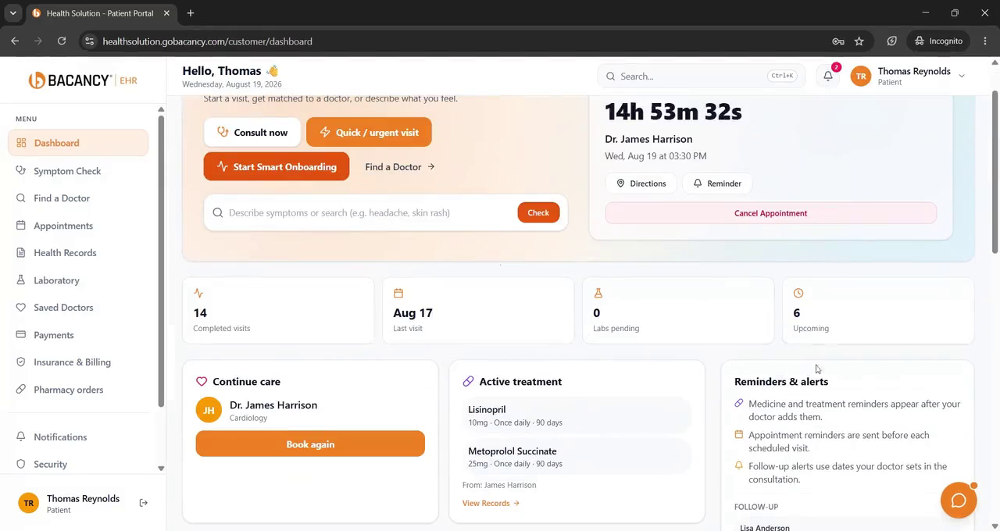

# Bacancy EHR: Technical Documentation

Integration guides, user guides and FHIR R4 details for Bacancy EHR.

**Product page, pricing and demo:** [bacancycare.com/ehr](https://bacancycare.com/ehr?utm_source=github&utm_medium=readme&utm_campaign=ehr&utm_content=product-top)

## What's in this repo
| Page | What you'll find |
|---|---|
| [Overview](docs/overview.md) | What Bacancy EHR covers and who uses it |
| [Integrations](docs/integrations.md) | FHIR R4, HL7 v2, Epic, Oracle Health (Cerner), labs, pharmacies |
| [User guides](docs/user-guide/README.md) | Step-by-step guides for front desk, physicians and admins |
| [Security and compliance](docs/security-and-compliance.md) | HIPAA support, ISO/IEC 27001:2022 |
| [Technical FAQ](docs/faq.md) | Integration and data questions |
| [Videos](media/videos.md) | Demo and how-to videos |
| [Changelog](CHANGELOG.md) | Documentation versions |

## Standards supported
FHIR R4 · HL7 v2 · SMART on FHIR · LOINC · SNOMED CT · RxNorm

## For developers
Free synthetic FHIR R4 test data: [healthcare-fhir-samples](https://github.com/bacancy-technology/healthcare-fhir-samples)

## How to cite
Use **Cite this repository** in the sidebar.

## Product details and pricing
Features, pricing and demos are on the official product page:
**[bacancycare.com/ehr](https://bacancycare.com/ehr?utm_source=github&utm_medium=readme&utm_campaign=ehr&utm_content=product-bottom)**

---
Documentation licensed under CC BY 4.0. Code samples in `samples/` licensed under Apache 2.0. Bacancy and Bacancy EHR are trademarks of Bacancy Technology. All screenshots use demo data.
