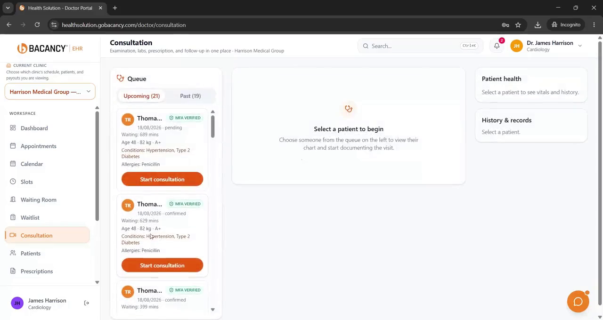

# Doctor Portal Guide

▶️ **Video guide (2:41)**

https://github.com/user-attachments/assets/2ebc1eb1-fe59-4acb-bc16-f74fd6c37523

## What doctors can do
Work across every clinic from one place: schedule, patient queue, consultations, prescriptions, video visits and earnings.

## Daily workflow
1. Open the dashboard to see today's schedule, the patient queue and any emergencies.
2. Open a patient from the queue to start the consultation.
3. Review history and vitals in the consultation workspace.
4. For a video visit, start the secure video call.
5. Write a prescription with dose, frequency and duration.
6. Order lab tests. The order goes to a partner lab.
7. Close the visit. The patient gets a prescription PDF.

## Manage your availability
Set slots, breaks and leave for each clinic.

## Earnings
See earnings reports across all the clinics you work at.
